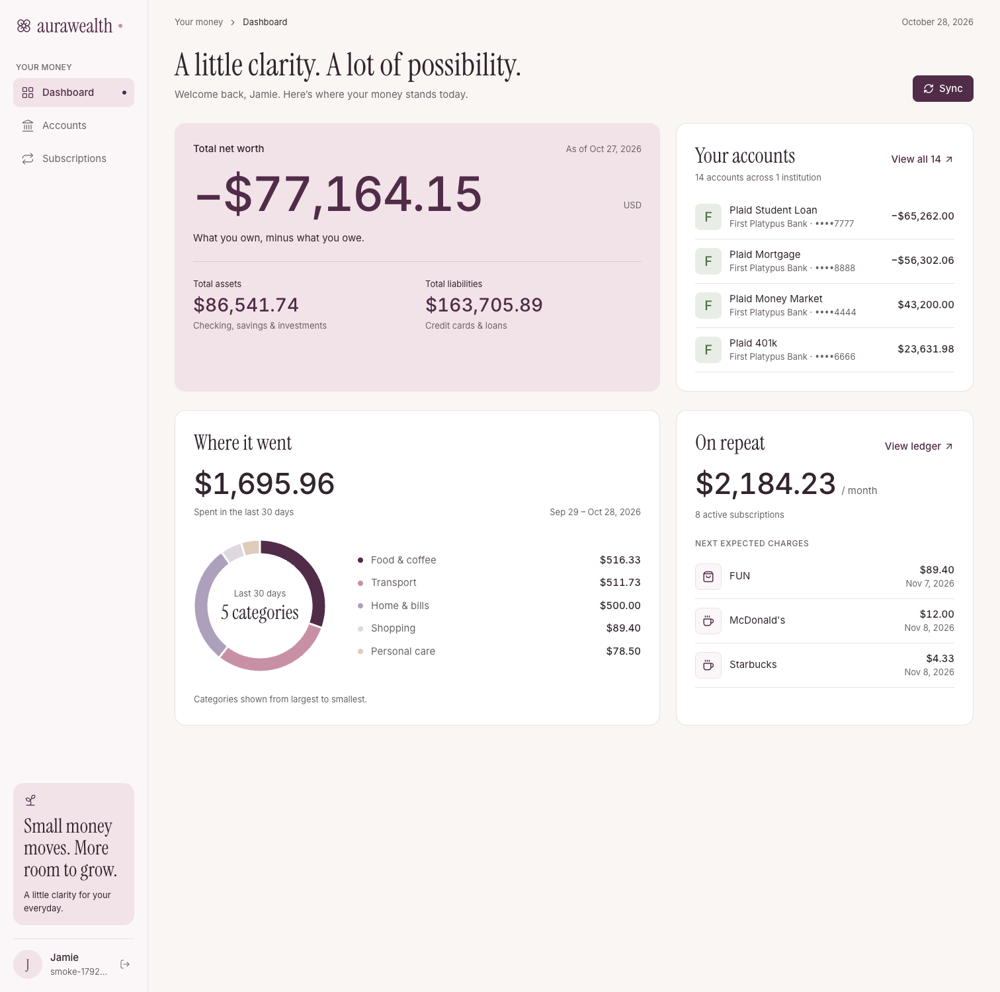
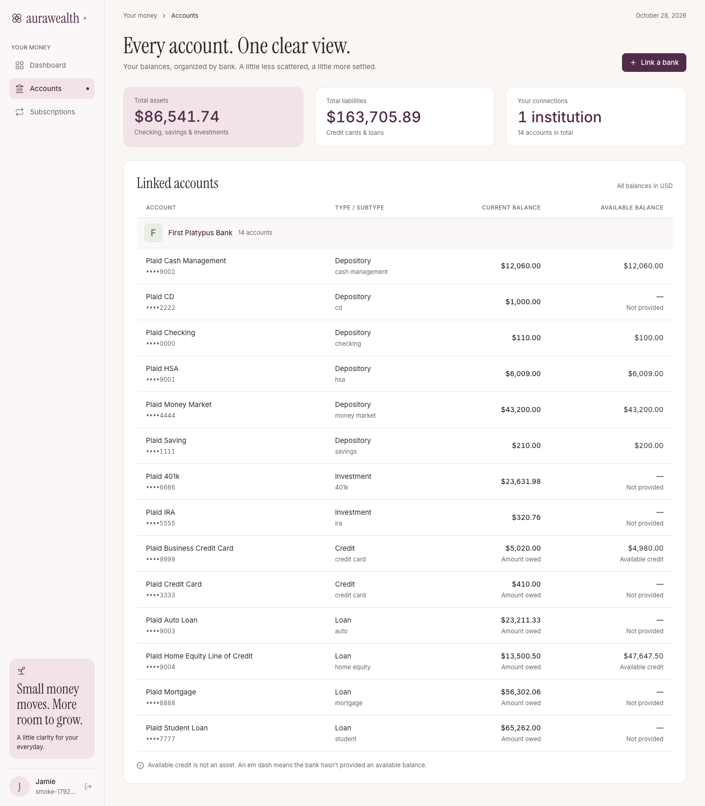
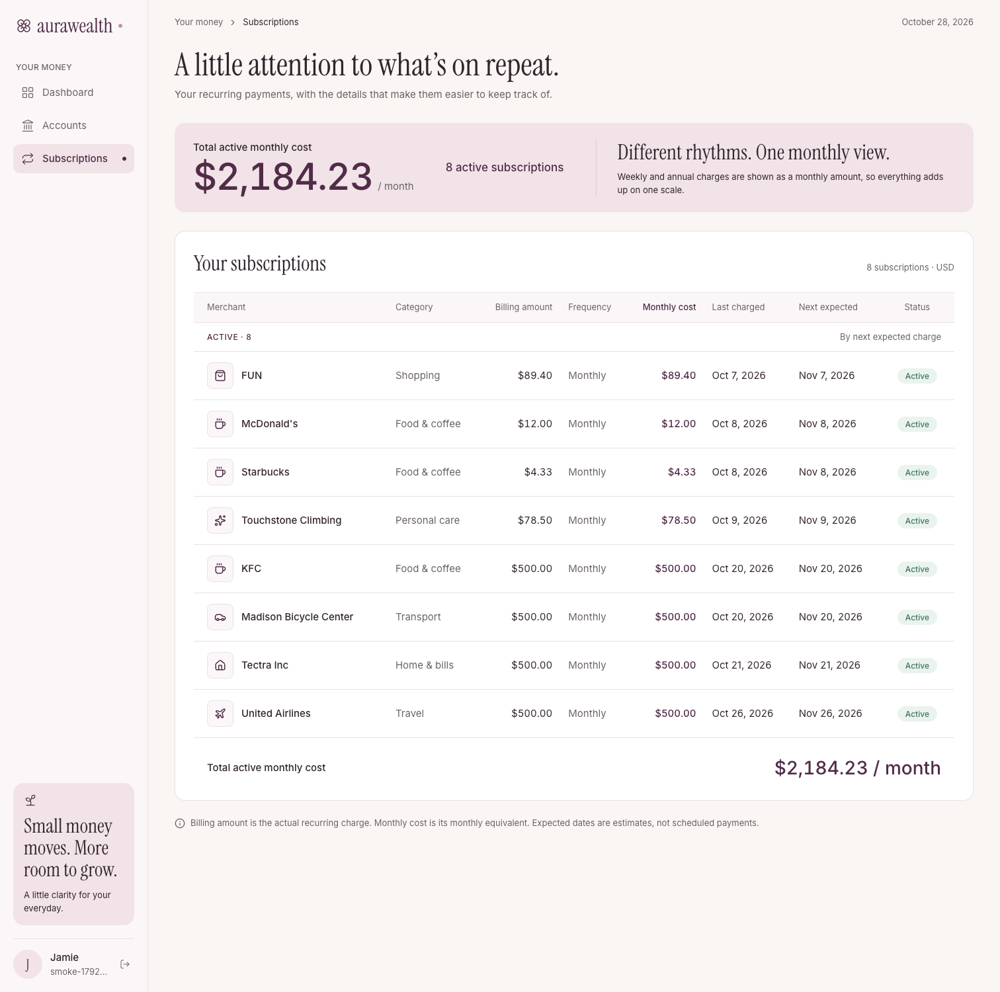
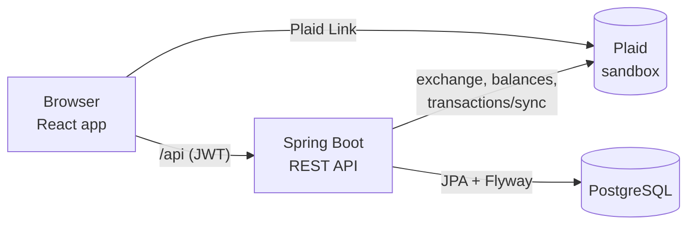

# AuraWealth

[](https://github.com/mermmin/aurawealth/actions/workflows/ci.yml)

**A calm personal-finance dashboard: link your bank, see your net worth, where your money went, and what's quietly charging you every month.**

**Live demo: [aurawealth-ktmi.onrender.com](https://aurawealth-ktmi.onrender.com)**



## Try it

1. Open the [live demo](https://aurawealth-ktmi.onrender.com) and choose **Create account** (any email; nothing is sent).
2. Go to **Accounts → Link a bank** and pick **First Platypus Bank**.
3. Sign in with Plaid's sandbox test login: `user_good` / `pass_good`.

You'll get 14 accounts (checking, savings, investments, credit cards and loans), three months of transactions, and the subscriptions detected from them. Everything runs on [Plaid's sandbox](https://plaid.com/docs/sandbox/): no real bank data is ever used.

## What it does

- **Net worth** across every linked account, with assets and liabilities split out. Shows how current it is (as of the *oldest* bank sync, since a total is only as fresh as its stalest bank).
- **Where it went:** spending by category over the last 30 days, with transfers, card payments and income excluded and refunds netted against purchases.
- **On repeat:** recurring charges are detected from transaction history (weekly, monthly or annual), with a monthly-equivalent cost, the next expected charge, and active/inactive status.
- **Accounts** grouped by bank, with amounts owed, available credit, and clear placeholders when a bank doesn't report a value.
- **Link a bank** through Plaid Link; balances and transactions sync on link and on demand.

| Accounts | Subscriptions |
|---|---|
|  |  |

## Tech stack

| Layer | |
|---|---|
| **Frontend** | React 19, TypeScript, Vite, Tailwind CSS v4, TanStack Query, React Router, Recharts, react-plaid-link |
| **Backend** | Java 17, Spring Boot 4.1, Spring Security (stateless JWT, BCrypt), Spring Data JPA, Maven |
| **Database** | PostgreSQL 17, Flyway migrations |
| **Integration** | Plaid API (sandbox): Link, token exchange, balances, `/transactions/sync` |
| **Testing** | JUnit 5, Mockito, MockMvc; repository and controller tests run against real Postgres |
| **CI / hosting** | GitHub Actions; one Docker image on Render; Postgres on Neon |

## Architecture



The React build is served by Spring Boot from the same origin as the API, so the whole app ships as **one Docker image** (Node builds the frontend, Maven builds the jar, a slim JRE runs it). No CORS, no API URL to configure.

## Decisions worth a look

- **Plaid access tokens are encrypted at rest** (AES-256-GCM via a JPA `AttributeConverter`, random IV per write). A database dump alone doesn't expose bank access. [`EncryptedStringConverter`](src/main/java/com/aurawealth/security/EncryptedStringConverter.java)
- **Spending nets refunds** in SQL, per category. Counting only purchases showed a fully refunded $500 flight as travel spending. [`TransactionRepository`](src/main/java/com/aurawealth/transaction/TransactionRepository.java)
- **Recurring-charge detection** is plain Java with explicit rules: every gap between charges must fit one frequency (weekly 5–9 days, monthly 26–35, annual 350–380), at least 3 charges (2 for annual), and every amount within 20% of the median, loose enough for real price rises ($15.49 → $17.99). A subscription goes inactive once its next charge is overdue by a grace period. [`RecurringChargeDetector`](src/main/java/com/aurawealth/subscription/RecurringChargeDetector.java)
- **Sync is idempotent and cursor-based.** `/transactions/sync` pages are collected first, then applied in one database transaction with the cursor saved last; a mid-pagination change from Plaid restarts from the saved cursor.
- **Fails fast in production.** With the `prod` profile, startup stops and names every missing setting, instead of falling back to a dev default or failing later with a confusing error. [`ProductionSettingsCheck`](src/main/java/com/aurawealth/ProductionSettingsCheck.java)
- **Errors are RFC 9457 problem JSON** (400, 401, 409, 502), and Plaid failure details are logged, never returned.
- **Designed before built.** Mockups first ([`docs/design/`](docs/design/)), then design tokens measured from them, with muted text colors darkened to pass WCAG AA contrast.

## API

All endpoints except auth need `Authorization: Bearer <token>`.

| Endpoint | Description |
|---|---|
| `POST /api/auth/register` | Create an account (email, password, optional display name) and get a JWT |
| `POST /api/auth/login` | Log in and get a JWT |
| `GET /api/me` | The signed-in user |
| `POST /api/plaid/link-token` | Start Plaid Link |
| `POST /api/plaid/exchange` | Finish linking: save the bank and its accounts |
| `POST /api/plaid/sync` | Refresh balances and transactions, then re-detect subscriptions |
| `GET /api/accounts` | Linked accounts |
| `GET /api/dashboard/net-worth` | Assets, liabilities, net worth and as-of time |
| `GET /api/dashboard/spending` | Spending by category, last 30 days |
| `GET /api/subscriptions` | Detected subscriptions, active first, by next charge |

## Run it locally

Requires Java 17+, Node 22 and Docker Desktop.

```bash
cp .env.example .env            # add your Plaid sandbox keys (free at dashboard.plaid.com)
docker compose up -d            # Postgres
./mvnw spring-boot:run          # API on http://localhost:8080
cd frontend && npm install && npm run dev   # app on http://localhost:5173
```

Or run the production image:

```bash
docker build -t aurawealth .
docker run -p 8080:8080 --env-file .env \
  -e DB_URL=jdbc:postgresql://host.docker.internal:5432/aurawealth aurawealth
```

## Tests

97 backend tests: Mockito unit tests for services and detection rules, MockMvc controller tests (auth, validation, problem JSON), and `@DataJpaTest` repository tests against **real Postgres** (no in-memory database, so the SQL that runs in production is the SQL that's tested).

```bash
docker compose up -d
./mvnw verify
cd frontend && npm run lint && npm run build
```

[GitHub Actions](.github/workflows/ci.yml) runs both on every pull request and push to `main`, with a Postgres service container for the backend.
